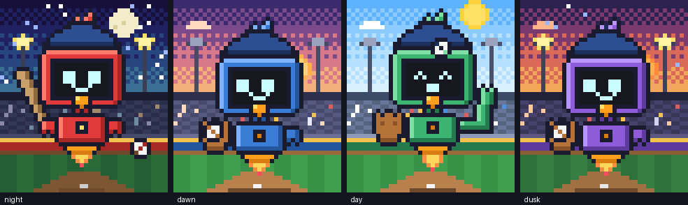
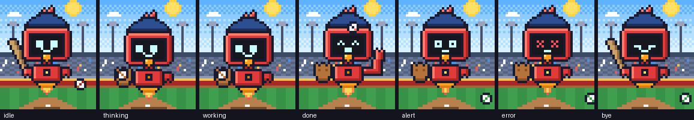
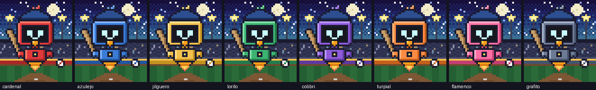

# Pixo

Un robot cardenal beisbolero en pixel art que vive en un panel de [Claude Code](https://code.claude.com) y reacciona a lo que pasa en tu sesión. Flota en un estadio que cambia con la hora del día, batea mientras espera tu mensaje, sale al campo con el guante cuando Claude trabaja y lanza la pelota al aire cuando termina. Cada sesión tiene su propio plumaje, para distinguirlas de un vistazo cuando corres varias a la vez.



Pixo es un **mod**: un plugin de Claude Code que corre dentro de su proceso y dibuja en la interfaz. No usa ventanas externas ni procesos aparte.

## Requisitos

- Claude Code **2.1.287 o superior** (`claude --version`). Los mods existen desde esa versión.
- Una terminal con color verdadero: iTerm2, Terminal de macOS, Ghostty, Warp, WezTerm, Kitty. En el Desktop app y en VS Code también funciona, dibujando con texto en vez de celdas.

## Instalación

```bash
git clone https://github.com/gchirinos/pixo.git ~/claude-mods/pixo
claude plugin validate ~/claude-mods/pixo
```

Para probarlo en una sola sesión:

```bash
claude --plugin-dir ~/claude-mods/pixo
```

Para dejarlo siempre activo, agrega la carpeta a `CLAUDE_CODE_PLUGIN_DIRS` en `~/.claude/settings.json`, con la ruta absoluta (sin `~`):

```json
{
  "env": {
    "CLAUDE_CODE_PLUGIN_DIRS": "/Users/TU_USUARIO/claude-mods/pixo"
  }
}
```

Si ya tienes un bloque `env`, añade solo la clave; para varios mods, separa las rutas con `:`. Reinicia Claude Code y confirma con `/plugin`: debajo de las pestañas debe decir «1 mod active · pixo».

Al arrancar, Pixo abre su panel al lado de la conversación si la terminal tiene al menos 144 columnas (a pantalla completa). Si es más angosta, escribe `/pixo` y se abre igual.

## Qué hace



| Momento | Pixo |
| :- | :- |
| Esperando tu mensaje | Bate al hombro. Flota, pestañea, mira a los lados y saluda de vez en cuando: «Bateador al cajón cuando quieras.» |
| Mandaste un prompt | Sale al campo con el guante, mira de un lado a otro y la pelota gira: «¡Play ball!», «Leyendo la señal del catcher…» |
| Claude usa una herramienta | Dice qué hace: «Bola en juego: editando archivos…», «Corriendo las bases: ejecutando un comando…» |
| Claude terminó de responder | Cara feliz, lanza la pelota desde el ala derecha y la atrapa en el guante: «¡Jonrón!», «¡Doble play! Cerramos la entrada.» |
| Claude pide permiso o una respuesta | Ojos bien abiertos, la pelota se le cae al piso: «¡Tiempo! El mánager pide tu seña.» |
| Una herramienta falló | Ojos en X y la pelota rueda: «¡Foul! A batear de nuevo.» |
| La sesión termina | Cierra los ojos y apaga el propulsor: «Se apagan las luces del estadio.» |

Las frases se eligen al azar de una lista por estado y rotan en las esperas largas. Están en `PHRASES`, al inicio de `hooks/register.js`.

## El estadio y la hora

El fondo es un estadio: torres de luz, graderías con público, la barda de los jardines con su línea amarilla (la barda toma el color del look de la sesión), pista de advertencia, césped con franjas y la tierra del cuadro con una base. Pixo mira el reloj de tu máquina: amanecer de 6 a 8, día de 8 a 17, atardecer de 17 a 20 y noche el resto. De noche se encienden las torres y salen la luna y las estrellas; de día hay sol y nubes; al amanecer y al atardecer el sol está bajo y el cielo se tiñe.

`/pixo hora dia | noche | amanecer | atardecer` lo fija durante la sesión; `/pixo hora auto` vuelve al reloj.

## Un plumaje por sesión



Cada sesión recibe un look: `cardenal`, `azulejo`, `jilguero`, `lorito`, `colibri`, `turpial`, `flamenco` o `grafito`. El panel muestra arriba el nombre de la sesión en ese color, y debajo el título de la sesión de Claude Code.

Cómo decide quién es cada sesión:

1. **Dentro de un pane de [herdr](https://herdr.dev)**: lee `HERDR_PANE_ID` y pregunta a `herdr pane get`. Usa, en este orden, el nombre del agente si lo nombraste, la etiqueta del pane (`herdr pane rename …`) o el grupo del workspace tal como aparece en la barra de herdr. El título de la sesión se refresca cada 20 s. El color queda ligado al pane, así que sobrevive a cambios de título y a reinicios.
2. **Fuera de herdr**: el nombre del repositorio o de la carpeta donde arrancaste `claude`.
3. **A mano**, por encima de lo anterior: `/pixo nombre <texto>` y `/pixo color <look>` se guardan para esa sesión/pane. Las variables `PIXO_NAME` y `PIXO_COLOR` mandan sobre todo (por ejemplo `herdr pane split --env PIXO_COLOR=azul`).

Los colores se reparten entre las sesiones vivas de la máquina: cada sesión deja un latido en el store compartido del mod y una sesión nueva toma el look menos usado entre las activas, así que ocho sesiones a la vez salen con ocho colores distintos.

## Comandos

| Comando | Qué hace |
| :- | :- |
| `/pixo` | Muestra u oculta el panel |
| `/pixo color <look>` | Fija el look de esta sesión (`verde`, `azul`, `rojo`… también sirven) |
| `/pixo nombre <texto>` | Fija el nombre que se muestra |
| `/pixo equipo bate \| guante \| auto` | Bate siempre, guante siempre, o que cambie solo según el momento |
| `/pixo hora dia \| noche \| amanecer \| atardecer \| auto` | Luz del estadio durante la sesión |
| `/pixo colores` | Lista los looks y dice cuál está activo |
| `/pixo auto` | Borra lo fijado a mano y vuelve a decidir solo |

Teclas en el panel: `Ctrl+X` y luego `Tab` le da el foco (`Esc` lo devuelve al prompt); con el panel enfocado, `p` lanza la pelota («Play ball»); `Ctrl+X` y luego `←` lo ensancha si quedó angosto; `Ctrl+X` y luego `X` lo cierra.

## Cómo funciona

```
.claude-plugin/plugin.json   manifiesto del plugin
hooks/hooks.json             apunta al módulo de hooks
hooks/register.js            todo el mod
docs/                        imágenes de este README
```

`register.js` registra hooks de Claude Code (`session.start`, `prompt.submit`, `tool.call`, `turn.complete`, `classic.Notification`, `classic.PostToolUseFailure`, `session.end`) para mover a Pixo, y un hook `ui.render` que dibuja el panel. En la terminal la escena de 40×46 píxeles se pinta con un elemento `Raster` usando medios bloques (`▀`: color de primer plano para el píxel de arriba y fondo para el de abajo); en el Desktop app y VS Code se dibuja con filas de `Text`. Un reloj de 100 ms anima los cuadros. Los sprites son cadenas de texto al principio del archivo y la paleta está en `P`; para cambiar colores, escena, frases o animación, ese es el único archivo que tocar.

## Licencia

Pixo fue creado por Guillermo Chirinos, sin fines de lucro. Cualquiera puede usarlo, copiarlo o adaptarlo para que lo acompañe mientras desarrolla. Se publica bajo licencia MIT; Pixo es un personaje original hecho para este proyecto.
